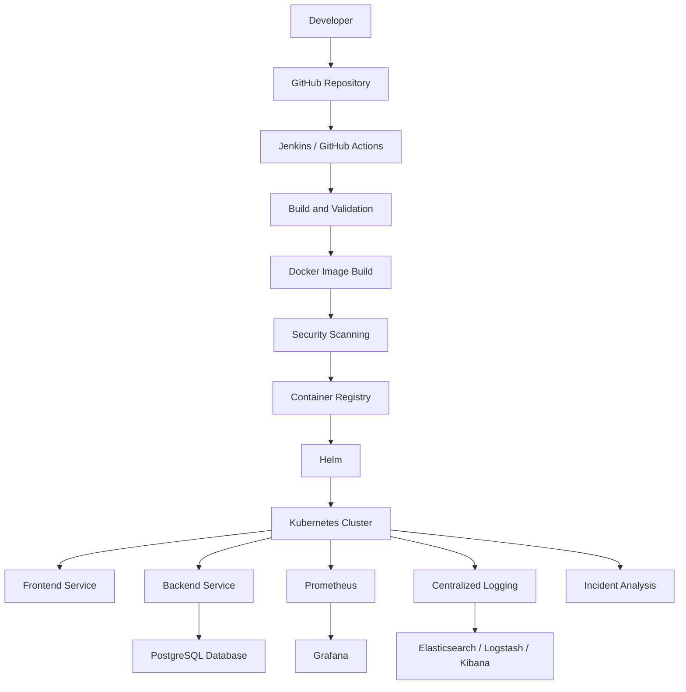

# AI-Powered E-Commerce DevOps & Cloud-Native Delivery Platform

<p align="center">
  <strong>A DevOps-driven e-commerce platform demonstrating containerization, Kubernetes orchestration, CI/CD automation, Infrastructure as Code, monitoring, logging, and AI-assisted incident analysis.</strong>
</p>

---

## Project Overview

The **AI-Powered E-Commerce DevOps & Cloud-Native Delivery Platform** is an internship project focused on applying modern DevOps and cloud-native practices to an e-commerce application.

The project aims to establish an automated and scalable application delivery environment using Docker, Kubernetes, Helm, Jenkins, GitHub Actions, Terraform, Ansible, Prometheus, Grafana, and the ELK Stack.

It also includes an AI-assisted incident analysis component designed to help identify operational issues and provide troubleshooting guidance.

The project follows a local-first implementation approach using Ubuntu on WSL, Docker, and a local Kubernetes cluster.

## Objectives

- Containerize frontend and backend application services using Docker.
- Integrate PostgreSQL for persistent data storage.
- Orchestrate application containers using Kubernetes.
- Manage Kubernetes deployments using Helm.
- Design CI/CD workflows using Jenkins and GitHub Actions.
- Explore Infrastructure as Code using Terraform.
- Automate configuration management using Ansible.
- Design application monitoring using Prometheus and Grafana.
- Implement centralized logging using the ELK Stack.
- Include security validation using Trivy and Gitleaks.
- Develop a rules-based AI incident analysis component.

## Architecture



*Note: This diagram represents the intended integrated platform architecture. Not all integrations have completed end-to-end execution.*

## Technology Stack

| Category | Technologies |
|---|---|
| Operating System | Ubuntu on WSL |
| Application | Node.js, JavaScript |
| Database | PostgreSQL |
| Containerization | Docker, Docker Compose |
| Orchestration | Kubernetes, kind |
| Deployment Management | Helm |
| CI/CD | Jenkins, GitHub Actions |
| Infrastructure as Code | Terraform |
| Configuration Management | Ansible |
| Monitoring | Prometheus, Grafana |
| Logging | Elasticsearch, Logstash, Kibana |
| Security | Trivy, Gitleaks |
| Incident Analysis | Python |
| Version Control | Git, GitHub |

## Repository Structure

```text
ai-ecommerce-devops/
│
├── application/
│   ├── backend/
│   └── frontend/
│
├── docker/
│   ├── Dockerfiles
│   ├── docker-compose.yml
│   └── nginx configuration
│
├── kubernetes/
│   ├── Kubernetes manifests
│   └── kind configuration
│
├── helm/
│   └── ecommerce/
│       ├── Chart.yaml
│       ├── values.yaml
│       └── templates/
│
├── jenkins/
│   └── Jenkinsfile
│
├── .github/
│   └── workflows/
│       └── ci.yml
│
├── terraform/
│
├── ansible/
│
├── monitoring/
│   ├── Prometheus/
│   └── Grafana/
│
├── logging/
│   └── elk/
│
├── security/
│
├── ai/
│   └── incident-analysis/
│       └── analyze.py
│
├── scripts/
│
├── docs/
│   ├── 01-implementation-guide.md
│   ├── 02-architecture.md
│   └── 03-troubleshooting.md
│
├── Implementation.pdf
└── README.md
```

## Prerequisites

Install the following tools before starting the project:

- Ubuntu on WSL or a Linux environment
- Docker Engine
- Docker Compose
- kubectl
- kind
- Helm
- Git
- Terraform
- Ansible

Check installed versions:

```bash
docker --version
docker compose version
kubectl version --client
kind version
helm version
terraform version
ansible --version
```

## Getting Started

### 1. Clone the Repository

```bash
git clone https://github.com/nisha-subramaniyan/ai-ecommerce-devops.git

cd ai-ecommerce-devops
```

### 2. Start the Application Using Docker Compose

The project provides a Docker Compose configuration for the frontend, backend and PostgreSQL database.

```bash
docker compose -f docker/docker-compose.yml up -d --build
```

Check running containers:

```bash
docker ps
```

Check service status:

```bash
docker compose -f docker/docker-compose.yml ps
```

View logs:

```bash
docker compose -f docker/docker-compose.yml logs -f
```

Stop the application:

```bash
docker compose -f docker/docker-compose.yml down
```

To remove containers and the database volume, use the following command only when you intentionally want to delete the stored database data:

```bash
docker compose -f docker/docker-compose.yml down -v
```

### 3. Verify Backend Health

The backend provides health and readiness endpoints.

```bash
curl http://localhost:3000/health
```

Database readiness:

```bash
curl http://localhost:3000/ready
```

Application metrics:

```bash
curl http://localhost:3000/metrics
```

API version:

```bash
curl http://localhost:3000/api/version
```

The actual host port may depend on the Docker Compose port mappings.

### 4. Create a Local Kubernetes Cluster

The project uses kind to create a local multi-node Kubernetes environment.

```bash
kind create cluster \
  --name shop \
  --config kubernetes/kind-config.yaml
```

Check cluster information:

```bash
kubectl cluster-info
```

Check nodes:

```bash
kubectl get nodes
```

Check pods:

```bash
kubectl get pods -A
```

If using a separate kind kubeconfig:

```bash
export KUBECONFIG=/tmp/shop-kubeconfig
```

Use the kubeconfig generated or configured for your own environment.

### 5. Validate the Helm Chart

Validate the chart:

```bash
helm lint helm/ecommerce
```

Render Kubernetes manifests:

```bash
helm template shop helm/ecommerce
```

These commands validate the chart structure and generated Kubernetes templates without installing the application.

### 6. Deploy Using Helm

Before deployment, ensure that:

- The application images are accessible to the Kubernetes nodes.
- The image repository and tags match the available images.
- A secure PostgreSQL password is configured.
- The Kubernetes context points to the intended cluster.

For an initial deployment without ingress, use a suitable values override:

```bash
helm upgrade --install shop helm/ecommerce \
  --set ingress.enabled=false \
  --set postgres.password="$POSTGRES_PASSWORD"
```

Set `POSTGRES_PASSWORD` to a strong, generated password before running the command. Review the chart's values and secret configuration first, and never commit real passwords to Git.

After deployment, verify the resources:

```bash
kubectl get deployments
kubectl get pods
kubectl get services
```

The Helm installation is a deployment instruction; successful rollout must be confirmed in the target cluster.

## CI/CD Workflow

The project includes Jenkins and GitHub Actions configuration intended to support an automated delivery pipeline.

The planned workflow is:

1. Developer pushes code to GitHub.
2. CI/CD pipeline is triggered.
3. Source code is checked out.
4. Application build and validation are performed.
5. Docker images are built.
6. Security scanning is performed.
7. Images are pushed to a container registry.
8. Helm deploys the application to Kubernetes.
9. Application health is verified.

## Infrastructure Automation

### Terraform

Terraform is included for Infrastructure as Code.

The objective is to manage infrastructure using declarative configuration rather than manual provisioning.

### Ansible

Ansible is included for configuration management and automation.

It is intended to simplify repeatable configuration and operational tasks.

## Monitoring and Logging

### Prometheus and Grafana

Prometheus and Grafana are included in the project's observability architecture.

- Prometheus collects application and infrastructure metrics.
- Grafana visualizes collected metrics through dashboards.

### ELK Stack

The project includes ELK configuration for centralized logging.

- Elasticsearch stores and indexes logs.
- Logstash processes and forwards log data.
- Kibana provides log visualization and analysis.

## Security Integration

Security tooling is included as part of the intended delivery workflow.

| Tool | Purpose |
|---|---|
| Trivy | Container image and vulnerability scanning |
| Gitleaks | Secret detection in source code and repositories |

These tools are intended to help identify security issues before application deployment.

## AI-Powered Incident Analysis

The project includes a Python-based incident analysis component:

```text
ai/incident-analysis/analyze.py
```

The component is designed to support rules-based incident analysis and troubleshooting guidance.

Potential future improvements include:

- Automated log analysis.
- Detection of common operational failures.
- Suggested troubleshooting steps.
- Integration with monitoring alerts.
- Optional integration with a local or cloud-based language model.

## Testing and Validation

The following implementation activities have been verified:

| Component | Status |
|---|---|
| Docker environment | Verified |
| PostgreSQL container | Healthy |
| Backend container | Healthy |
| Backend health endpoint | HTTP 200 verified |
| kind Kubernetes cluster | Three nodes Ready |
| Local registry catalog | Repositories and tags visible |
| Helm lint | Passed |
| Helm template rendering | Passed |
| Registry image manifest retrieval | Requires troubleshooting |
| Kubernetes application rollout | Pending verification |
| Jenkins end-to-end pipeline | Pending verification |
| GitHub Actions execution | Pending verification |
| Terraform execution | Pending verification |
| Ansible execution | Pending verification |
| Prometheus and Grafana integration | Pending verification |
| ELK log ingestion | Pending verification |
| Security scanning workflow | Pending verification |
| AI incident analysis execution | Pending verification |

## Current Implementation Status

The project has established a local development environment and validated several core components.

**Completed and verified:**
- Docker and Docker Compose environment setup.
- PostgreSQL and backend container health verification.
- Backend health endpoint testing.
- Three-node kind cluster setup.
- Helm chart linting and template rendering.
- Local registry configuration and repository inspection.

**Further work required:**
- Resolve container registry manifest retrieval issues.
- Make application images available to kind nodes.
- Complete the Kubernetes application rollout.
- Verify frontend and backend communication in Kubernetes.
- Execute and validate CI/CD workflows.
- Validate Terraform and Ansible automation.
- Complete monitoring, logging and security integration.
- Execute and validate the AI incident analysis component.

## Challenges Encountered

### Database Connectivity

The backend initially experienced database connectivity issues because the PostgreSQL service was not running. Starting the database before the backend resolved the initial service availability issue.

### Kubernetes Context

The default Kubernetes context did not point to the intended kind cluster. A separate kubeconfig was used to access the correct cluster.

### Container Registry

The local registry displayed the application repositories and tags, but image manifest requests returned HTTP 404. Further investigation is required before the application can be deployed successfully to Kubernetes.

### Kubernetes Image Availability

The application images were not present in the kind nodes' image lists. Image loading and registry connectivity require additional validation.

## Future Enhancements

- Complete Kubernetes application deployment.
- Implement reliable rolling updates and rollback.
- Integrate fully automated CI/CD.
- Complete Terraform infrastructure provisioning.
- Automate configuration using Ansible.
- Build operational dashboards in Grafana.
- Enable centralized logging through ELK.
- Integrate automated security checks into CI/CD.
- Improve AI-assisted incident analysis.
- Extend the platform to a cloud environment such as AWS.
- Implement production-grade secrets management and access controls.

## Documentation

Additional project documentation is available in the `docs/` directory:

- `01-implementation-guide.md` – Implementation guide.
- `02-architecture.md` – Architecture documentation.
- `03-troubleshooting.md` – Troubleshooting reference.

The repository also includes `Implementation.pdf`.

## Author

**Nisha Subramaniyan**

DevOps | Cloud Computing | DevSecOps

GitHub: [nisha-subramaniyan](https://github.com/nisha-subramaniyan)

## Project Information

| Field | Details |
|---|---|
| Project | AI-Powered E-Commerce DevOps & Cloud-Native Delivery Platform |
| Organization | Davine Technologies |
| Domain | DevOps |
| Environment | Ubuntu on WSL |
| Repository | [ai-ecommerce-devops](https://github.com/nisha-subramaniyan/ai-ecommerce-devops) |

---

## License

This project is developed for internship and educational purposes. Add an appropriate open-source license if you intend to distribute or reuse the project publicly.
