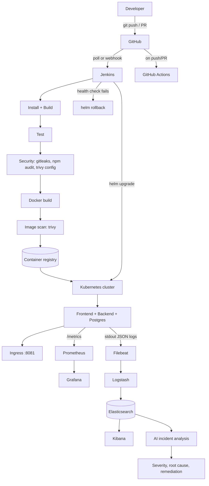
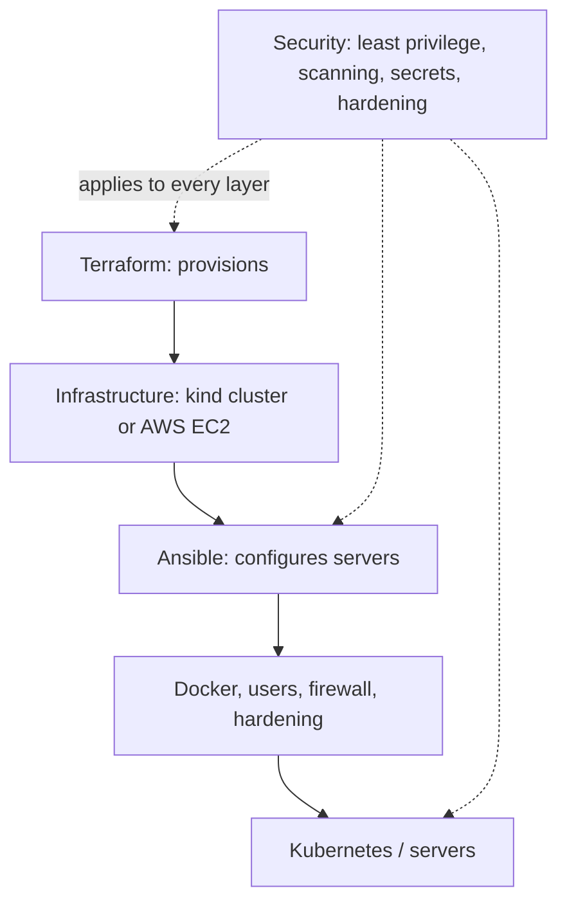

# Architecture

## 1. End-to-end delivery flow



## 2. Infrastructure layers (underneath the delivery flow)



## 3. Runtime topology (Kubernetes)

```
Browser -> localhost:8081 -> kind node port mapping -> ingress-nginx
        -> Service "frontend" (:80) -> frontend pods (Nginx :8080, serves static files)
              -> /api/*  -> Service "backend" (:3000) -> backend pods (Node)  -> Service "shop-postgres" (:5432) -> Postgres pod + PVC
```

## 4. Technology -> role (as defined in the report)

| Category | Technology | Role in this repo |
|---|---|---|
| OS | Linux (Ubuntu/WSL) | runs everything; `scripts/setup.sh`, `security/linux-hardening.sh` |
| Version control / collaboration | Git, GitHub | branching `main`/`develop`/`feature/*`, PRs |
| Automation | Bash | `scripts/*.sh` |
| Web server / reverse proxy | Nginx | `docker/nginx.conf` |
| Containerisation | Docker, Compose | `docker/` |
| CI/CD | Jenkins (+ GitHub Actions alternative) | `jenkins/`, `.github/workflows/ci.yml` |
| Infrastructure | Terraform | `terraform/` (kind local, AWS EC2) |
| Configuration | Ansible | `ansible/` |
| Orchestration | Kubernetes (kind) | `kubernetes/`, `helm/` |
| Packaging | Helm | `helm/ecommerce` |
| Monitoring | Prometheus, Grafana | `monitoring/` |
| Logging | ELK (+ Filebeat) | `logging/elk/` |
| Security | gitleaks, npm audit, Trivy, hardening, NetworkPolicy | `security/`, pipeline stages |
| AI | rules engine / Ollama / Claude API | `ai/incident-analysis/` |
| Cloud | AWS (Terraform module) / Oracle Always Free (Ansible) | Step 16 of the guide |

## 5. Key design decisions

* **kind instead of a managed cloud cluster** - free and behaves like real Kubernetes; only the Terraform `target` differs for a cloud.
* **Local registry** (`localhost:5001`) - same push/pull flow as ECR/ACR/Docker Hub without a paid account.
* **Helm for deployments, raw YAML for learning** - both are kept so the objects can be explained and the release can be versioned/rolled back.
* **JSON logs + `/metrics` in the app** - the app is designed to be observable; ELK and Prometheus need no code changes.
* **Rules-first AI** - deterministic and free; an LLM is an optional upgrade with automatic fallback.
* **Security gates** - CRITICAL image vulnerabilities, high+ dependency issues and any detected secret fail the pipeline; misconfiguration findings are advisory.
* **Lab shortcuts (documented, not for production)** - Jenkins uses the host Docker socket; Elasticsearch has security disabled; default demo passwords; kind's CNI does not enforce NetworkPolicy.
